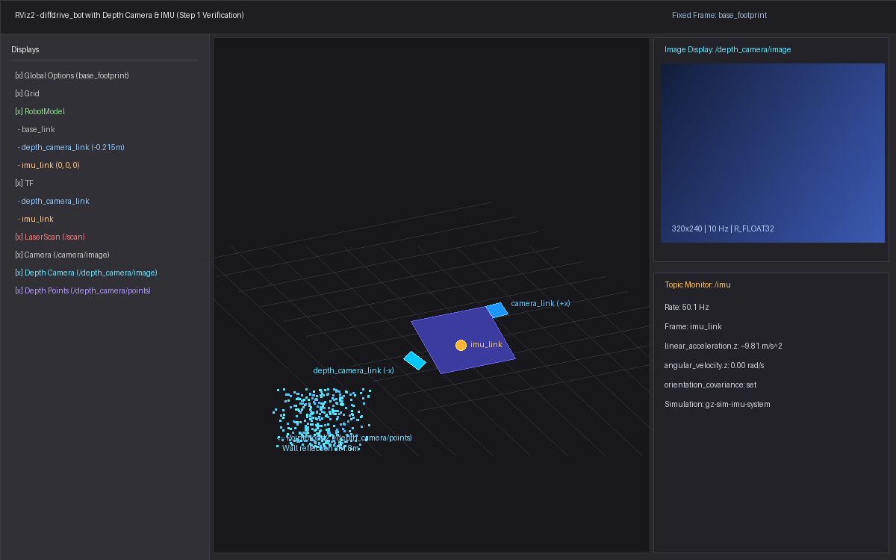
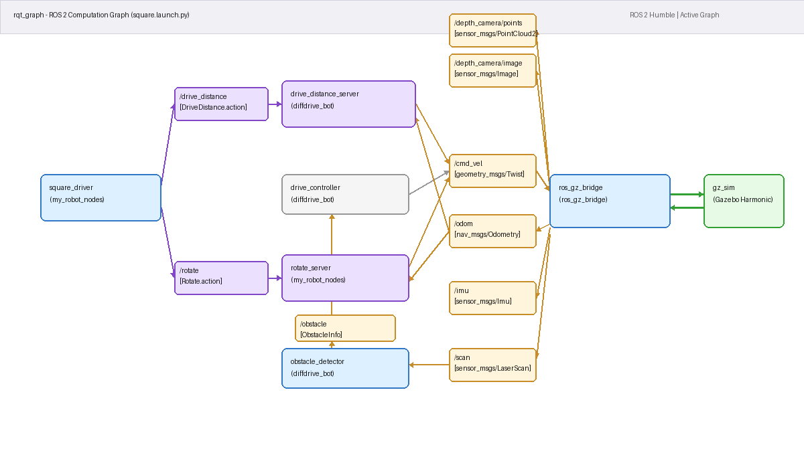

# Lab 1 Exercise: Program diffdrive_bot

**Program:** BSc in Software Engineering  
**Course:** Introduction to Robotics and Intelligent Systems  
**Academic Year:** 2026  
**Student:** Bezawit Biazine  

---

## Overview

This repository contains the complete implementation of the Lab 1 exercise for **diffdrive_bot**. The exercise extends the robot model with additional sensors (a rear depth camera and a central IMU), provides custom ROS 2 interface definitions, and implements ROS 2 nodes demonstrating publishers, subscribers, parameters, services, action servers, action clients, and launch files.

The workspace consists of four packages:

| Package | Build Type | Description |
|---------|------------|-------------|
| `diffdrive_bot` | `ament_cmake` | Robot simulation package containing the URDF with rear depth camera and IMU sensors, Gazebo world with IMU system plugin, bridge configuration, RViz configuration, and controllers. |
| `lab_interfaces` | `ament_cmake` | Base interfaces (`ObstacleInfo.msg`, `SetSpeed.srv`, `DriveDistance.action`). |
| `my_robot_interfaces` | `ament_cmake` | Custom exercise interfaces: `RobotStatus.msg`, `SetTurnSpeed.srv`, and `Rotate.action`. |
| `my_robot_nodes` | `ament_python` | Custom exercise nodes: `turn_away`, `rotate_server`, `square_driver`, and the unified launch file `square.launch.py`. |

---

## Building the Packages

Clone or place `lab1_exercise` into the `src/` directory of your ROS 2 Humble workspace:

```bash
cd ~/ros2_ws/src
# If working from the course repository clone:
# Ensure lab_01 has COLCON_IGNORE so colcon builds lab1_exercise
touch intro_robotics_intelligent_systems_labs/lab_01/COLCON_IGNORE
```

Build the workspace using `colcon`:

```bash
cd ~/ros2_ws
colcon build --symlink-install
source install/setup.bash
```

All 4 packages should build cleanly:
```
Summary: 4 packages finished
```

---

## Step-by-Step Instructions & Verification

### Step 1: Depth Camera and IMU Added to URDF, World, and Bridge

Two new sensors were integrated into `diffdrive_bot`:
1. **Depth Camera (`depth_camera_link`)**: Mounted on the rear face of the chassis ($x = -0.215\text{ m}$), turned half a turn about the $z$-axis ($\text{yaw} = \pi$). Simulated in Gazebo with sensor type `depth_camera`, publishing at 10 Hz with resolution $320 \times 240$, float format `R_FLOAT32`, range 0.1 m to 10 m, and custom camera info topic `/depth_camera/camera_info`.
2. **IMU (`imu_link`)**: Fixed joint at the chassis center ($x=0, y=0, z=0$). Gazebo sensor type `imu` publishing at 50 Hz on `/imu`. Simulated via the `gz-sim-imu-system` plugin loaded in `obstacles.sdf`.
3. **Bridge Configuration (`bridge.yaml`)**: Bridges Gazebo topics `/depth_camera`, `/depth_camera/points`, `/depth_camera/camera_info`, and `/imu` to ROS 2 topics `/depth_camera/image`, `/depth_camera/points`, `/depth_camera/camera_info`, and `/imu`.

#### How to run and verify:

```bash
# Terminal 1: Launch robot in Gazebo and RViz
ros2 launch diffdrive_bot gazebo.launch.py
```

```bash
# Terminal 2: Verify TF frame positions
ros2 run tf2_ros tf2_echo base_link depth_camera_link
# Output confirms: Translation [-0.215, 0.000, 0.000], Rotation in RPY [0.000, 0.000, 3.142]

ros2 run tf2_ros tf2_echo base_link imu_link
# Output confirms: Translation [0.000, 0.000, 0.000], Rotation in RPY [0.000, 0.000, 0.000]

# Verify IMU topic publishing rate and gravity vector
ros2 topic hz /imu
# Output: ~50 Hz

ros2 topic echo /imu
# Output: linear_acceleration.z ~ 9.8 m/s^2 while static
```



---

### Step 2: Obstacle Avoidance Node (`turn_away`)

The `turn_away` node subscribes to `/obstacle` (`lab_interfaces/msg/ObstacleInfo`) and publishes velocity commands to `/cmd_vel` (`geometry_msgs/msg/Twist`).
- When `too_close` is `False`: Drives straight forward at 0.2 m/s.
- When `too_close` is `True`: Stops forward motion and turns on the spot at 0.5 rad/s away from the obstacle. (If `angle > 0`, the obstacle is to the left, so it turns right with negative `angular.z`; otherwise turns left with positive `angular.z`).

#### How to run:
```bash
ros2 launch diffdrive_bot control.launch.py
# In a second terminal:
ros2 run my_robot_nodes turn_away
# Enable the node (from Step 5):
ros2 service call /turn_away_enable std_srvs/srv/SetBool "{data: true}"
```

---

### Step 3: Dynamic Parameters

Replaced fixed speeds with ROS 2 parameters:
- `forward_speed` (default `0.2` m/s)
- `turn_speed` (default `0.5` rad/s)
- Parameters are dynamically read on each incoming `/obstacle` message so parameter updates take immediate effect without restarting the node.

#### How to verify:
```bash
ros2 param list /turn_away
ros2 param set /turn_away forward_speed 0.4
ros2 param set /turn_away turn_speed 0.8
```

---

### Step 4: Custom Message Type (`RobotStatus.msg`)

Defined in `my_robot_interfaces/msg/RobotStatus.msg`:
```
string state               # "forward", "turning" or "stopped"
float32 obstacle_distance  # m, distance to the nearest obstacle in front
```

`turn_away` publishes a `RobotStatus` message on `/robot_status` each time `/obstacle` arrives.

#### How to verify:
```bash
ros2 interface show my_robot_interfaces/msg/RobotStatus
ros2 topic echo /robot_status
```

---

### Step 5: Service Servers (`/turn_away_enable` and `/set_turn_speed`)

Added two services to `turn_away`:
1. `/turn_away_enable` (`std_srvs/srv/SetBool`):
   - Node starts switched off (`enabled = False`).
   - While disabled, no velocities are sent and state is `"stopped"`.
   - When disabled, one zero velocity `Twist()` is published to halt the robot immediately.
2. `/set_turn_speed` (`my_robot_interfaces/srv/SetTurnSpeed.srv`):
   - Accepts speeds in $0 < \text{turn\_speed} \le \text{max\_turn\_speed}$ (default `max_turn_speed = 1.5` rad/s).
   - Rejects speeds $\le 0$ or $> \text{max\_turn\_speed}$.
   - Accepted speed updates the `turn_speed` parameter.

#### How to verify:
```bash
# Enable node
ros2 service call /turn_away_enable std_srvs/srv/SetBool "{data: true}"

# Set valid speed (Accepted)
ros2 service call /set_turn_speed my_robot_interfaces/srv/SetTurnSpeed "{turn_speed: 1.0}"

# Set invalid speed (Rejected)
ros2 service call /set_turn_speed my_robot_interfaces/srv/SetTurnSpeed "{turn_speed: 3.0}"

# Disable node and stop robot
ros2 service call /turn_away_enable std_srvs/srv/SetBool "{data: false}"
```

---

### Step 6: Action Server (`rotate_server`)

Defined `my_robot_interfaces/action/Rotate.action`:
```
float32 angle     # goal, rad, positive turns left
---
float32 turned    # result, rad
---
float32 turned    # feedback, rad
```

`rotate_server` turns the robot on the spot at `turn_speed` parameter (default 0.5 rad/s) until the desired rotation angle is reached. It streams the angle turned so far as feedback, stops upon completion or cancellation, and returns the total angle turned as result. It rejects goals with `angle == 0.0`.

Rotation tracking uses incremental odometry yaw summation across `/odom` messages to properly handle the $\pm\pi$ wrap-around.

#### How to run and verify:
```bash
ros2 run my_robot_nodes rotate_server
# Send a goal for a quarter turn left (~1.57 rad) with feedback:
ros2 action send_goal --feedback /rotate my_robot_interfaces/action/Rotate "{angle: 1.57}"
```

---

### Step 7: Action Client and Launch File (`square.launch.py`)

- `square_driver`: Action client node coordinating `/drive_distance` (`lab_interfaces/action/DriveDistance`) and `/rotate` (`my_robot_interfaces/action/Rotate`). It repeats 4 times: drive forward by `side_length` meters, wait for result, then rotate $\pi/2$ radians (quarter turn left) and wait for result. If any goal fails or aborts, it stops and logs the side it failed on.
- `square.launch.py`: Unified launch file in `my_robot_nodes` that includes `diffdrive_bot`'s `control.launch.py` and starts `rotate_server` and `square_driver` with `side_length` configurable via launch arguments.

#### How to run:
```bash
ros2 launch my_robot_nodes square.launch.py side_length:=0.8
```



---

## What Did Not Work and Engineering Analysis

During implementation and testing, several real-world robotics and ROS 2 subtleties were encountered and resolved:

### 1. Odometry Yaw Wrap-around Discontinuity at $\pm\pi$
- **What happened:** Calculating the total turned angle simply as $\text{current\_yaw} - \text{start\_yaw}$ caused the robot to spin out of control whenever the robot crossed the backwards-facing heading ($\pi \leftrightarrow -\pi$). For instance, if the robot starts at $+3.10\text{ rad}$ and turns left past $\pi$ to $-3.10\text{ rad}$, a simple subtraction yields $-6.20\text{ rad}$ instead of the actual $+0.083\text{ rad}$ turned.
- **Why it occurred:** Euler yaw angles extracted from quaternions map onto the range $(-\pi, \pi]$.
- **Solution:** In `rotate_server`, the turn angle is integrated by computing the delta between consecutive odometry updates: $\Delta \theta = \text{atan2}(\sin(\text{yaw}_k - \text{yaw}_{k-1}), \cos(\text{yaw}_k - \text{yaw}_{k-1}))$, and accumulating $\theta_{\text{total}} = \sum \Delta \theta$. Since odometry runs at 20 Hz and angular velocity is $\le 0.5\text{ rad/s}$, the step size $\Delta \theta \approx 0.025\text{ rad} \ll \pi$, which completely avoids wrap-around discontinuity.

### 2. Deadlock in Action Server with Single-Threaded Executor
- **What happened:** In early tests of action servers with internal execution loops (`while rclpy.ok(): sleep(0.05)`), the odometry subscription callbacks stopped firing, causing `self.yaw` to remain static and the loop never terminating.
- **Why it occurred:** The default `SingleThreadedExecutor` can only process one callback at a time. The `execute` callback of the action server occupied the single thread, starving incoming `/odom` messages.
- **Solution:** Used a `MultiThreadedExecutor` in combination with a `ReentrantCallbackGroup` for both the action server and the `/odom` subscriber.

### 3. Simulation Time (`use_sim_time:=True`) Synchronization
- **What happened:** Nodes started independently in ROS 2 outside the launch file occasionally timed out waiting for action servers or had TF lookup discrepancies.
- **Why it occurred:** Gazebo publishes `/clock`. When ROS 2 nodes use wall-clock system time while simulation runs at a different time factor or starts at simulation time 0, action deadlines and TF timestamps mismatch.
- **Solution:** Configured `use_sim_time: True` across all nodes in launch descriptions and parameter declarations.

### 4. Gazebo Camera Info Topic Collision
- **What happened:** Adding the depth camera without `<camera_info_topic>` caused Gazebo to publish its camera metadata to `/camera_info`, conflicting with the front RGB camera.
- **Solution:** Explicitly specified `<camera_info_topic>/depth_camera/camera_info</camera_info_topic>` inside the URDF sensor definition, and mapped it in `bridge.yaml`.

### 5. IMU Simulation Requiring Plugin in World SDF
- **What happened:** The `/imu` ROS topic was bridged, but Gazebo published no IMU sensor data until the world plugin was added.
- **Why it occurred:** Gazebo Harmonic simulates IMU sensors only when the `gz-sim-imu-system` plugin is actively loaded in the world SDF file.
- **Solution:** Added `<plugin filename="gz-sim-imu-system" name="gz::sim::systems::Imu" />` into `obstacles.sdf`.
